  

# 🚀 Awesome Distributed SQL Query Engine

### ⚡ Curated Directory of Distributed SQL Engines, Federated Query Processors & Lakehouse Analytics Platforms

  
  
  
  
  
  
  
  

  <b>🌟 Star this repository to support open-source distributed data systems! 🌟</b>

---

## 📖 Overview & SEO Summary

Welcome to the definitive directory for **Distributed SQL Query Engines**, **Data Lakehouse Query Processors**, **Massively Parallel Processing (MPP)** architectures, and **Federated Analytics** platforms. Whether you need a fully managed cloud warehouse with serverless elasticity or high-performance open-source query execution over petabyte-scale Apache Iceberg, Delta Lake, Apache Hudi, or object storage (Amazon S3, Google Cloud Storage, Azure Blob), this guide categorizes modern analytical query systems.

Key architectural paradigms featured:
- 🌐 **Federated Query Engines**: Query disparate data stores without data movement (Trino, Presto, Amazon Athena).
- ⚡ **Vectorized OLAP & Single-Table Engines**: Sub-second aggregations on wide tables with SIMD optimizations (ClickHouse, Apache Doris, Apache StarRocks).
- 🦆 **In-Process / Embedded Analytics**: Serverless vectorized execution right inside client applications (DuckDB, Apache DataFusion).
- ☁️ **Cloud Data Warehouses & Managed Lakehouses**: Scalable separation of compute and storage (Google BigQuery, Snowflake, Starburst Galaxy, Dremio Cloud).
- 🔄 **Unified Large-Scale Processing**: Fault-tolerant batch ETL, SQL, and ML at scale (Apache Spark SQL).

---

## 📑 Table of Contents

- [📊 Sector Overview & Market Dynamics](#-sector-overview--market-dynamics)
- [☁️ SaaS / Hosted Platforms](#️-saas--hosted-platforms)
- [🛠️ Open-Source GitHub Projects](#️-open-source-github-projects)
- [🤝 How to Contribute](#-how-to-contribute)
- [💖 Support & Sponsorship](#-support--sponsorship)
- [📈 Star History](#-star-history)
- [⚖️ Disclaimer](#️-disclaimer)

---

## 📊 Sector Overview & Market Dynamics

The global distributed query engine and cloud data warehouse market is estimated between **$12B and $15B** and projected to surpass **$50B+** by the early 2030s (expanding at a CAGR > 25%). 

Rather than a winner-take-all monopoly, the sector is **highly fragmented**:
- **Storage-Compute Decoupling**: The standardisation of open table formats (**Apache Iceberg**, **Delta Lake**) completely separates the query engine layer from storage, ending proprietary lock-in.
- **Polyglot & Multi-Cloud Architectures**: Enterprises actively distribute data across AWS, GCP, Azure, and on-premises systems, driving rapid adoption of federated query layers (Trino, Presto) and hybrid platforms.
- **Coexistence of Niches**: Massive hyperscalers (BigQuery, Athena) thrive alongside independent cloud giants (Snowflake, Databricks), while vectorized native engines (ClickHouse, StarRocks) and embedded engines (DuckDB, DataFusion) capture real-time and edge analytical workloads.

---

## ☁️ SaaS / Hosted Platforms

| Platform | 🏢 Company Valuation / Revenue | 💳 Starting Tier Pricing | 🎁 Free Tier / Trial Limits | 🏗️ Architecture & Focus | 🎯 Best For | ⚖️ Trade-offs |
| :--- | :--- | :--- | :--- | :--- | :--- | :--- |
| **Google BigQuery** | ~$2.1T Market Cap (Alphabet parent) / Google Cloud ~$40B+ ARR | $6.25 per TB scanned (On-Demand) or $0.04/slot-hour (Standard Edition) | **Free Forever Plan**: 1 TB queries/month scanned and 10 GB active storage free every month; plus 90-day $300 new GCP account credit trial | Serverless, multi-cloud MPP analytical query engine & data warehouse with BigQuery Omni federation | Zero-ops serverless query execution over massive datasets | On-demand scan costs can spike without partition/cluster filters; capacity reservation requires planning |
| **Amazon Athena** | ~$2.0T Market Cap (Amazon parent) / AWS ~$105B+ ARR | $5.00 per TB scanned (SQL queries, 10 MB min. per query) | **Free Trial / Companion Free Tiers Only**: Athena has no core free queries (bills from first query), but companion free tiers include AWS Glue (1M objects/requests free/mo) and S3 (5 GB free for 12 mos on new accounts) | Serverless interactive federated query service built on Presto/Trino running queries directly over S3 and federated connectors | Ad-hoc analytics on Amazon S3 without ETL or infrastructure management | Expenses depend heavily on file layout and compression; poorly partitioned tables drive high scan charges |
| **Snowflake** | ~$110B Market Cap / ~$3.5B+ ARR | $2.00 per credit (Standard Edition compute) + $23.00/TB/month storage (AWS US East) | **30-Day Free Trial**: 30-day trial with $400 in usage credits (whichever expires first, no credit card required) | Multi-cluster, shared-data architecture separating compute, centralized storage, and cloud services | Fully managed elastic analytics with complete workload concurrency isolation | Pure consumption model requires strict warehouse auto-suspend and credit governance |
| **Starburst Galaxy** | $3.35B Valuation (Series D) / $100M+ ARR | $0.50 per Starburst credit (Galaxy Pro tier) | **Free Forever Plan**: 3 active clusters forever free; plus a **30-day Free Trial** loaded with $500 usage credits | Fully managed Trino-as-a-Service for lakehouse federation across hybrid and multi-cloud stores | Production-grade managed Trino federation without operational cluster maintenance | Credit burn scales dynamically with concurrent query volume and warehouse cluster size |
| **Dremio Cloud** | $2.0B Valuation (Acquired by SAP, 2026) / ~$50M–$65M ARR | $0.20 per DCU (Dremio Compute Unit, Pay-As-You-Go) | **Free Forever Plan**: Forever-free Standard tier limited to 10 users, Small engine sizes, and 200 catalog tables; plus a **30-day Free Trial** with $400 evaluation credits | Apache Iceberg & Apache Arrow native lakehouse query execution and semantic acceleration engine | Sub-second SQL queries on open lakehouses without proprietary vendor lock-in | Advanced governance, custom RBAC, and multi-engine auto-scaling reserved for enterprise tiers |

---

## 🛠️ Open-Source GitHub Projects

*Ranked in descending order by GitHub stargazers count:*

1. **[Apache Spark](https://github.com/apache/spark)** 
   - 📌 **Description**: The standard unified engine for large-scale distributed batch SQL (Spark SQL), streaming, and machine learning pipelines, scaling to thousands of nodes with resilient mid-query fault tolerance.
   - 💻 **Tech stack**: Scala, Java, Python | 📜 **License**: Apache-2.0
   - 🚀 **Deploy**: Self-hosted (Kubernetes, YARN, standalone) or managed (Databricks, EMR, Google Cloud Dataproc).
   - 🎯 **Best for**: Unified data engineering, ETL, and ML pipelines at petabyte scale.
   - ⚠️ **Trade-off**: High JVM overhead and task startup latency; suboptimal for sub-second interactive ad-hoc BI queries.

2. **[ClickHouse](https://github.com/ClickHouse/ClickHouse)** 
   - 📌 **Description**: Blazing-fast column-oriented distributed DBMS built for real-time analytical reporting, featuring vectorized execution, specialized MergeTree engines, and Robin Hood hash tables.
   - 💻 **Tech stack**: C++ | 📜 **License**: Apache-2.0
   - 🚀 **Deploy**: Self-hosted (bare metal, Kubernetes) or ClickHouse Cloud.
   - 🎯 **Best for**: Real-time event streams, observability logs, telemetry, and sub-second aggregations on wide tables.
   - ⚠️ **Trade-off**: Slower multi-table JOIN performance compared to MPP query engines; not optimized for frequent row-level updates or point lookups.

3. **[DuckDB](https://github.com/duckdb/duckdb)** 
   - 📌 **Description**: High-performance in-process columnar analytical SQL engine ("the SQLite for Analytics"), featuring vectorized execution, disk spilling, and native Parquet/Iceberg querying.
   - 💻 **Tech stack**: C++ | 📜 **License**: MIT
   - 🚀 **Deploy**: Embedded (Python, R, Node.js, CLI binaries, WebAssembly).
   - 🎯 **Best for**: Local analytical processing, serverless data pipelines, interactive data science, and edge workloads.
   - ⚠️ **Trade-off**: Single-node architecture; cannot scale horizontally across a distributed multi-machine cluster.

4. **[Presto](https://github.com/prestodb/presto)** 
   - 📌 **Description**: The original open-source distributed SQL query engine created at Facebook, governed by the Linux Foundation / Presto Foundation, featuring native C++ worker acceleration (Velox / Presto C++).
   - 💻 **Tech stack**: Java, C++ (Velox) | 📜 **License**: Apache-2.0
   - 🚀 **Deploy**: Self-hosted (Kubernetes, AWS EMR).
   - 🎯 **Best for**: Interactive querying against distributed data lakes (Hive, Iceberg) and heterogeneous data sources.
   - ⚠️ **Trade-off**: Smaller open-source developer momentum compared to Trino; Velox native runtime is undergoing continuous stabilization.

5. **[Apache Doris](https://github.com/apache/doris)** 
   - 📌 **Description**: High-performance, real-time analytical database and distributed query engine based on MPP architecture, supporting both high-concurrency point queries and high-throughput ad-hoc lakehouse analytics.
   - 💻 **Tech stack**: C++, Java | 📜 **License**: Apache-2.0
   - 🚀 **Deploy**: Self-hosted (Kubernetes, Docker, Linux binaries).
   - 🎯 **Best for**: Real-time dashboards, user-facing analytics, and unified lakehouse querying over Iceberg and Hive.
   - ⚠️ **Trade-off**: Resource-intensive memory management; requires careful pipeline tuning for high-frequency micro-batch ingestion.

6. **[Apache Druid](https://github.com/apache/druid)** 
   - 📌 **Description**: Distributed real-time analytical database and query engine designed for sub-second OLAP queries at high concurrency on streaming event data.
   - 💻 **Tech stack**: Java | 📜 **License**: Apache-2.0
   - 🚀 **Deploy**: Self-hosted (Kubernetes, Docker) or Imply Cloud.
   - 🎯 **Best for**: High-concurrency event-driven analytics, clickstream tracking, and operational metrics.
   - ⚠️ **Trade-off**: Complex multi-component operational topology (Historical, MiddleManager, Broker, Coordinator); inflexible complex JOIN support across non-replicated tables.

7. **[Trino](https://github.com/trinodb/trino)** 
   - 📌 **Description**: Fast distributed SQL query engine for big data and the de facto industry standard for federated query execution across heterogeneous stores without data duplication.
   - 💻 **Tech stack**: Java | 📜 **License**: Apache-2.0
   - 🚀 **Deploy**: Self-hosted (Kubernetes, Helm, Docker) or Starburst Galaxy.
   - 🎯 **Best for**: Federated cross-database queries across object storage (Iceberg, Delta Lake), relational databases, and NoSQL stores.
   - ⚠️ **Trade-off**: Higher JVM memory footprint than native C++/Rust engines; traditionally memory-bound with limited fault-tolerant execution unless configured with exchange spooling.

8. **[Apache StarRocks](https://github.com/StarRocks/starrocks)** 
   - 📌 **Description**: Next-generation sub-second MPP analytical query engine and real-time lakehouse database powered by a fully vectorized C++ execution pipeline and cost-based optimizer (CBO).
   - 💻 **Tech stack**: C++, Java | 📜 **License**: Apache-2.0
   - 🚀 **Deploy**: Self-hosted or CelerData Cloud.
   - 🎯 **Best for**: Real-time dashboards, multi-table JOIN acceleration, and direct query federation on Apache Iceberg, Hudi, and Delta Lake.
   - ⚠️ **Trade-off**: Demands substantial CPU and RAM resources for peak vectorized performance; relatively newer operational ecosystem outside Asia.

9. **[Apache DataFusion](https://github.com/apache/datafusion)** 
   - 📌 **Description**: Extremely fast, extensible embedded and distributed SQL query engine library written in Rust, leveraging Apache Arrow columnar memory format for vectorized query execution.
   - 💻 **Tech stack**: Rust | 📜 **License**: Apache-2.0
   - 🚀 **Deploy**: Embedded library (Rust crate, Python bindings) or distributed framework (Ballista).
   - 🎯 **Best for**: Building custom analytical platforms, database engines, and lightweight distributed query systems without JVM bloat.
   - ⚠️ **Trade-off**: Primary design is as an embeddable engine library rather than a turnkey monolithic database appliance.

10. **[Apache Pinot](https://github.com/apache/pinot)** 
    - 📌 **Description**: Real-time distributed OLAP datastore and query engine architected to execute low-latency analytical queries at ultra-high concurrency over ingested streaming feeds.
    - 💻 **Tech stack**: Java | 📜 **License**: Apache-2.0
    - 🚀 **Deploy**: Self-hosted (Kubernetes, Docker) or StarTree Cloud.
    - 🎯 **Best for**: User-facing real-time analytics applications (e.g., LinkedIn feed analytics, Uber Eats live dashboarding).
    - ⚠️ **Trade-off**: Limited ad-hoc complex query flexibility; queries perform best when data models match pre-configured star/snowflake schemas.

11. **[Apache Drill](https://github.com/apache/drill)** 
    - 📌 **Description**: Schema-free distributed SQL query engine that enables self-service interactive exploration across NoSQL databases, JSON, and cloud object stores without predefined schemas.
    - 💻 **Tech stack**: Java | 📜 **License**: Apache-2.0
    - 🚀 **Deploy**: Self-hosted (clustered or embedded).
    - 🎯 **Best for**: Ad-hoc exploration of nested semi-structured datasets and complex JSON files without schema definitions.
    - ⚠️ **Trade-off**: Lower single-node efficiency on heavy joins; development pace and modern lakehouse connector support have moderated compared to Trino.

12. **[Apache Impala](https://github.com/apache/impala)** 
    - 📌 **Description**: Massively parallel processing (MPP) native C++ SQL query engine designed for low-latency interactive BI queries directly on data stored in Apache Hadoop (HDFS, Apache Kudu, HBase).
    - 💻 **Tech stack**: C++, Java | 📜 **License**: Apache-2.0
    - 🚀 **Deploy**: Self-hosted (Cloudera CDP, Kubernetes, Hadoop clusters).
    - 🎯 **Best for**: Enterprise environments with heavy legacy on-premises Hadoop/Hive/Kudu infrastructure.
    - ⚠️ **Trade-off**: Tied strongly to the Hadoop/Hive metastore ecosystem; less agile for multi-cloud and modern object store lakehouses compared to Trino or StarRocks.

---

## 🤝 How to Contribute

Contributions are welcome! Help us keep this directory accurate, neutral, and comprehensive:
1. 🍴 Fork the repository.
2. 📝 Add or edit entries in `README.md` following the established table and item formats.
3. 🔍 Verify that starting tier pricing, free tier limits, and architecture details are factual and backed by official sources.
4. 📬 Submit a Pull Request with a clear summary of your changes.

---

## 💖 Support & Sponsorship

If this curated list saved you research hours or helped architect your data stack, please consider supporting the project:

- ⭐ **Star this repository** on GitHub to increase its visibility!
- 🍴 **Fork and share** it with your fellow data engineers and architects.
- ☕ **Buy a coffee & sponsor ongoing maintenance** via the [GitHub Sponsors Dashboard](https://github.com/sponsors/ishandutta2007).

Your support keeps this community directory updated with the latest releases, performance benchmarks, and industry pricing shifts!

---

## 📈 Star History

---

## ⚖️ Disclaimer

- 📌 This is an independent, **community-curated directory** — not an official endorsement of any vendor or project.
- 🔒 Distributed query engines executing across enterprise datasets must adhere to data governance and security frameworks (GDPR, HIPAA, SOC 2).
- 💡 **Architectural Trade-offs Matter**: Choose based on your primary bottleneck—**storage-backed data warehousing** (Snowflake, BigQuery), **heterogeneous query federation** (Trino, Presto, Athena), **ultra-fast single-table OLAP** (ClickHouse, StarRocks), **in-process analytics** (DuckDB, DataFusion), or **batch ETL & ML** (Spark SQL).
- 🛠️ Self-hosted solutions require infrastructure planning, security perimeter hardening, and tuning for production scale.

---

  <b>Built with ❤️ for data engineers, analytics architects, and database builders worldwide.</b>

